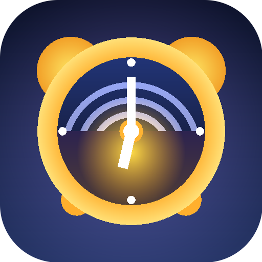
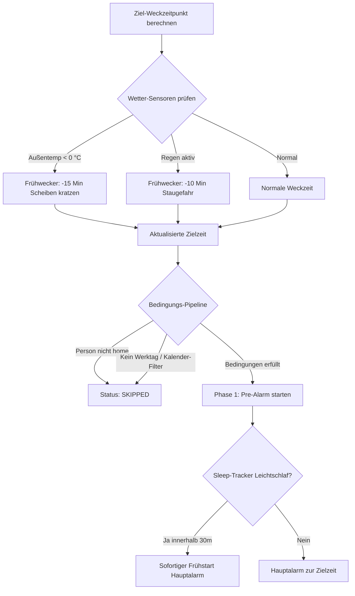

<p align="center">
  
</p>

<h1 align="center">Smart Wake</h1>
<p align="center"><b>Smarter Wecker für Home Assistant mit dynamischen Bedingungen, Phasen-Aktionen, Eskalation & Custom Side Panel Dashboard</b></p>

<p align="center">
  <a href="https://my.home-assistant.io/redirect/hacs_repository/?owner=vitals5&repository=ha-smart-wake&category=integration"></a>
</p>

<p align="center">
  <a href="https://hacs.xyz"></a>
  <a href="https://www.home-assistant.io/"></a>
  <a href="https://github.com/vitals5/ha-smart-wake/actions/workflows/validate.yml"></a>
  <a href="LICENSE"></a>
</p>

---

**Smart Wake** ist eine hochgradig anpassbare Custom Integration für Home Assistant, die das Konzept des klassischen Weckers revolutioniert. Sie kombiniert native Home Assistant Entitäten, intelligentes Sensor-Gating, eine dynamische Wetter- und Schlafphasen-Verschiebung, eine dreistufige Wecksequenz (Pre-Alarm bis Eskalation), echte Anti-Cheat-Quittierungen sowie ein dediziertes Custom Side Panel Dashboard.

---

## Inhaltsverzeichnis

- [Architektur & Instanz-Modell](#1-integrations-architektur--instanz-modell)
- [Intelligente Bedingungen & Dynamisches Triggern](#2-intelligente-bedingungen--dynamisches-triggern)
- [3-Phasen-Aktionen & Sequenzen](#3-phasen-aktionen--sequenzen)
- [Quittierung, Schlummern & Anti-Cheat](#4-quittierung-schlummern--anti-cheat)
- [Home Assistant Voice Assist](#5-voice-assist-integration)
- [Dediziertes Side Panel Dashboard](#6-custom-side-panel-dashboard)
- [Automations-Blueprints](#automations-blueprints)
- [Installation](#installation)
- [Dienste (Services)](#dienste-services)
- [Lizenz](#lizenz)

---

## 1. Integrations-Architektur & Instanz-Modell

Smart Wake basiert auf dem modernen Home Assistant `config_flow`-System:
* **Eigenständige Wecker-Instanzen:** Jede Instanz repräsentiert einen individuellen Wecker (z. B. *„Wecker Schlafzimmer“*, *„Wecker Kinderzimmer Richard“* oder *„Sanftes Erwachen Büro“*).
* **Eigener Config Entry pro Wecker:** Bequem über die HA-Oberfläche (*Einstellungen → Geräte & Dienste*) oder direkt über das Smart Wake Dashboard einricht- und editierbar.
* **Erzeugte Entitäten pro Instanz:**
  | Entität | Typ | Beschreibung |
  |---|---|---|
  | `time.<wecker_name>_time` | Native Time Entity | Direkte Zeiteinstellung via UI, Lovelace oder Sprachassistent (`time.set_value`). |
  | `switch.<wecker_name>_enabled` | Switch | Aktiviert oder deaktiviert den Wecker. |
  | `sensor.<wecker_name>_status` | Sensor | Live-Zustand: `idle`, `pre_alarm`, `ringing`, `snoozed`, `dismissed`, `skipped`. |
  | `sensor.<wecker_name>_next_alarm` | Timestamp Sensor | Nächster geplanter Weckzeitpunkt inkl. Wetter-Offset und Countdown-Attributen. |
  | `sensor.<wecker_name>_active_phase` | Sensor | Aktive Phase: `none`, `pre_alarm`, `main_alarm`, `escalation`. |
  | `sensor.<wecker_name>_snooze_count` | Sensor | Aktueller Schlummer-Zähler im laufenden Weckzyklus. |
  | `sensor.<wecker_name>_dynamic_offset` | Sensor | Berechnete Weckzeitverschiebung in Minuten (z. B. Frost/Regen). |
  | `button.<wecker_name>_snooze` | Button | Manuelles Schlummern. |
  | `button.<wecker_name>_dismiss` | Button | Manuelles Quittieren / Beenden. |
  | `button.<wecker_name>_test` | Button | Startet den 30-Sekunden-Zeitraffer-Testlauf. |
  | `button.<wecker_name>_skip_next` | Button | Überspringt einmalig den nächsten regulären Wecklauf. |
  | `number.<wecker_name>_snooze_duration` | Number (min) | Einstellbare Schlummerdauer (1 bis 60 Min, Standard: 9). |
  | `number.<wecker_name>_max_snooze_count` | Number | Maximal erlaubte Schlummer-Vorgänge (0 bis 10, Standard: 3). |
  | `number.<wecker_name>_pre_alarm_duration` | Number (min) | Dauer der sanften Vor-Alarm-Phase (0 bis 60 Min, Standard: 15). |

---

## 2. Intelligente Bedingungen & Dynamisches Triggern

Vor dem Wecken durchläuft jede Instanz eine intelligente Prüf- und Offset-Pipeline:



* **Werktage & Kalender:**
  * Direkte Kopplung mit `binary_sensor.workday_sensor` (nur an Arbeitstagen klingeln).
  * HA-Kalender-Integration (`calendar.*`): Optionales Auslösen nur bei Kalenderterminen oder Überspringen bei Urlaub/Schulferien.
* **Personen- & Anwesenheits-Tracking:**
  * Bindung an `person.*`-Entitäten. Ist die zugewiesene Person nicht zu Hause (`not_home`), überspringt der Wecker automatisch den Lauf (`status: skipped`).
* **Schlechtwetter- & Winter-Offset (Dynamische Weckzeitverschiebung):**
  * **Frost-Schutz:** Fällt die Außentemperatur unter 0 °C (z. B. `sensor.outdoor_temperature`), weckt der Wecker automatisch $X$ Minuten früher zum Scheiben kratzen.
  * **Regen-Erkennung:** Schlagen Regensensoren an, wird die Weckzeit um $Y$ Minuten vorverlegt.
* **Sleep-Tracker-Integration (Smart Wake Fenster):**
  * Überwacht Schlaftracker (z. B. Withings, Sleep As Android, Garmin, Apple Watch). Wechselt der Schlafstatus innerhalb von 30 Minuten vor dem Wecker auf Leichtschlaf (`light`, `awake`), startet die Wecksequenz im optimalen Biorhythmus-Moment.

---

## 3. Phasen-Aktionen & Sequenzen

Jede Wecker-Instanz durchläuft drei aufeinanderfolgende Phasen:

### Phase 1: Pre-Alarm (Sanftes Wecken)
* Startet $X$ Minuten vor der Weckzeit (Standard: 15 Minuten).
* **Licht-Transition:** Dimmbare Lampen (`light.*`) fahren über die gesamte Vor-Alarm-Dauer sanft von warmem Rot (1 %) bis zu tageslichtweißem Gelb (80 %) hoch.
* **Heizung:** Hebt die Zieltemperatur des Raumes (`climate.*`) um z. B. +2 °C an.
* **Rollos / Jalousien:** Kippt die Lamellen auf 20 % an (`cover.*`).
* **Skripte:** Führt optionale HA-Skripte (`script.*`) aus.

### Phase 2: Hauptalarm (Weckzeitpunkt)
* **Sanfter Audio-Fade-in:** Startet Web-Radio, Spotify-Playlists, lokale Chimes oder Sound-Dateien auf `media_player.*` und blendet die Lautstärke über konfigurierbare Sekunden (z. B. 30s) sanft auf die Ziellautstärke (z. B. 50 %) ein.
* **TTS-Morgenbriefing:** Liest ein dynamisches Template vor:
  > *„Guten Morgen! Es ist {time} Uhr, draußen sind es {temp}. Dein Wecker {name} ist aktiv.“*
* **HA-Skripte:** Ausführen individueller Aktionsfolgen.

### Phase 3: Eskalations-Modus (Anti-Verschlaf-Schutz)
* Wenn nach $Y$ Minuten (Standard: 10 Minuten) weder Schlummern noch Quittieren betätigt wurde:
  * **Audio-Lautstärke:** Schrittweise Erhöhung auf bis zu 90 %.
  * **Volle Beleuchtung:** Raum-Hauptbeleuchtung schaltet auf 100 % Kaltweiß (6500 K).
  * **Rollos:** Fahren zu 100 % komplett nach oben.

---

## 4. Quittierung, Schlummern & Anti-Cheat

### Quittierungs-Trigger (Dismiss)
Das Beenden des Alarms erfolgt nicht zwingend über das Smartphone, sondern über reale Smart-Home-Ereignisse:
* **Hardware-Taster:** Zigbee/Z-Wave-Schalter am Nachttisch (z. B. Einfachklick = Schlummern, Doppelklick = Quittieren).
* **Anti-Cheat Präsenzmelder:** Bewegungsmelder im Badezimmer oder in der Küche meldet Präsenz (Beweis für erfolgreiches Aufstehen).
* **NFC-Tag:** NFC-Tag am Badezimmerspiegel oder an der Kaffeemaschine wird gescannt.
* **Leistungssensor:** Die Leistungsaufnahme der Kaffeemaschine oder des Badezimmerlichts überschreitet den Grenzwert (z. B. > 10 W).

### Schlummer-Funktion (Snooze)
* Einstellbare Schlummerdauer (z. B. 5, 8, 9, 10 Minuten).
* **Snooze-Limit:** Nach Erreichen der maximalen Schlummer-Anzahl wird der Schlummer-Button blockiert – es bleibt nur noch der Quittier-Zwang!

---

## 5. Voice Assist Integration

Smart Wake unterstützt Home Assistant Assist und LLM-Integrationen über vordefinierte Sprachmuster auf Deutsch und Englisch:

* **Weckzeit setzen:**
  * *„Stelle den Wecker Schlafzimmer auf 06:45 Uhr.“*
  * *„Wecke mich morgen um 7 Uhr.“*
* **Status umschalten:**
  * *„Schalte den Wecker Schlafzimmer aus.“*
  * *„Aktiviere den Schul-Wecker.“*
* **Schlummern & Stoppen:**
  * *„Fünf Minuten weiterschlafen.“* → Triggert Snooze.
  * *„Ich bin wach.“* / *„Wecker stoppen.“* → Triggert Dismiss.

---

## 6. Custom Side Panel Dashboard

Die Integration registriert automatisch ein eigenes Icon in der Seitenleiste von Home Assistant (`/smart-wake`):

```text
┌─────────────────────────────────────────────────────────────┐
│  SMART WAKE DASHBOARD                       [ + Neuer Wecker]│
├─────────────────────────────────────────────────────────────┤
│  ┌───────────────────────────────────────────────────────┐  │
│  │ ⏰ Wecker Schlafzimmer                       [ AKTIV ] │  │
│  │ Zeit: 06:30 Uhr   |  Status: IDLE                     │  │
│  │ Tage: Mo, Di, Mi, Do, Fr  |  Workday-Filter: AN       │  │
│  │ Person: Vitali (Nur auslösen wenn anwesend)          │  │
│  ├───────────────────────────────────────────────────────┤  │
│  │ Phasen:                                               │  │
│  │  - 06:15: Pre-Alarm (Licht Fade-in, Rollos 20%)       │  │
│  │  - 06:30: Hauptalarm (TTS Briefing + Radio Lounge)    │  │
│  │  - 06:40: Eskalation (Volles Licht, Lautstärke 80%)  │  │
│  ├───────────────────────────────────────────────────────┤  │
│  │ Quittierung: Zigbee Taster Schlafzimmer (Doppelklick) │  │
│  │ Schlummern: 8 Min (Max: 2x)                           │  │
│  │                                 [Bearbeiten] [Testen] │  │
│  └───────────────────────────────────────────────────────┘  │
└─────────────────────────────────────────────────────────────┘
```

* **Live-Status-Monitoring:** Countdown bis zum nächsten Alarm unter Berücksichtigung aller Wetter-Offsets.
* **Testlauf-Modus (Dry-Run):** 30-Sekunden-Zeitraffer-Testlauf mit Live-Balkenanzeige, um Licht-Fade, Lautstärken und Rollo-Steuerung risikolos zu prüfen.
* **Direkt-Aktionen:** Schnelles Umschalten, Schlummern und Quittieren direkt im Browser.

---

## Automations-Blueprints

Smart Wake liefert gebrauchsfertige Blueprints mit 1-Click-Import für Home Assistant mit:

### 1. Anti-Cheat Quittierung
Quittiert automatisch, sobald Bewegung im Bad oder Aktivität an der Kaffeemaschine erkannt wird.

[](https://my.home-assistant.io/redirect/blueprint_import/?blueprint_url=https%3A%2F%2Fraw.githubusercontent.com%2Fvitals5%2Fha-smart-wake%2Fmain%2Fblueprints%2Fautomation%2Fsmart_wake%2Fanti_cheat_dismiss.yaml)

### 2. Hardware-Taster Steuerung
Belegt beliebige Zigbee- oder Z-Wave-Taster mit Einfachklick (Snooze) und Doppelklick (Dismiss).

[](https://my.home-assistant.io/redirect/blueprint_import/?blueprint_url=https%3A%2F%2Fraw.githubusercontent.com%2Fvitals5%2Fha-smart-wake%2Fmain%2Fblueprints%2Fautomation%2Fsmart_wake%2Fhardware_button_control.yaml)

### 3. Schlechtwetter-Frühwecker Benachrichtigung
Sendet am Vorabend oder am Morgen eine Smartphone-Push-Benachrichtigung über vorverlegte Weckzeiten.

[](https://my.home-assistant.io/redirect/blueprint_import/?blueprint_url=https%3A%2F%2Fraw.githubusercontent.com%2Fvitals5%2Fha-smart-wake%2Fmain%2Fblueprints%2Fautomation%2Fsmart_wake%2Fweather_early_wake_notification.yaml)

---

## Installation

### Option 1: HACS 1-Click Installation (Empfohlen)

Klicke einfach auf den folgenden Button, um das Smart Wake Repository direkt in deinem Home Assistant Community Store (HACS) zu öffnen und zu installieren:

[](https://my.home-assistant.io/redirect/hacs_repository/?owner=vitals5&repository=ha-smart-wake&category=integration)

1. Klicke in HACS auf **Herunterladen / Download**.
2. Starte Home Assistant neu.
3. Klicke auf den Button unten oder gehe zu **Einstellungen → Geräte & Dienste → Integration hinzufügen** und wähle **Smart Wake**:

[](https://my.home-assistant.io/redirect/config_flow_start/?domain=smart_wake)

---

### Option 2: Manuelle HACS-Einrichtung
1. Öffne **HACS** in Home Assistant.
2. Klicke oben rechts auf das Drei-Punkte-Menü `⋮` → **Benutzerdefinierte Repositories**.
3. Füge die Repository-URL ein:
   ```text
   https://github.com/vitals5/ha-smart-wake
   ```
4. Wähle als Kategorie **Integration**.
5. Klicke auf **Hinzufügen**, dann auf **Herunterladen**.
6. Starte Home Assistant neu.

---

### Option 3: Manuelle Datei-Installation
1. Lade das Release-Archiv oder das Repository herunter.
2. Kopiere den Ordner `custom_components/smart_wake` in dein Home Assistant Verzeichnis `config/custom_components/smart_wake`.
3. Starte Home Assistant neu.
4. Richte deinen ersten Wecker unter **Einstellungen → Geräte & Dienste → Integration hinzufügen → Smart Wake** ein.

---

## Dienste (Services)

| Dienst | Parameter | Beschreibung |
|---|---|---|
| `smart_wake.snooze` | `alarm_id`, `duration` | Schlummert einen aktiven Wecker für die konfigurierte Dauer oder benutzerdefinierte Minuten. |
| `smart_wake.dismiss` | `alarm_id` | Quittiert und beendet einen aktiven Wecker oder Vor-Alarm. |
| `smart_wake.test_alarm` | `alarm_id` | Startet den 30-Sekunden-Zeitraffer-Testlauf (Licht, Audio, Rollos). |
| `smart_wake.stop_test` | `alarm_id` | Bricht einen laufenden Testlauf sofort ab. |
| `smart_wake.set_time` | `alarm_id`, `time` | Setzt eine neue Weckzeit (z. B. `"06:45"`). |
| `smart_wake.skip_next` | `alarm_id`, `skip` | Überspringt einmalig den nächsten regulären Wecklauf. |

---

## Lizenz

Dieses Projekt ist unter der [MIT-Lizenz](LICENSE) lizenziert. Copyright (c) 2026 VitalS5.
